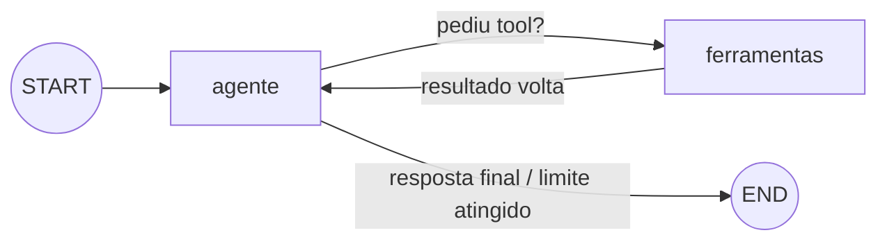

# 🧮 Calculadora com Agente de IA (LangGraph + Claude)

Uma calculadora de terminal em que **quem raciocina é um LLM (Claude)**, mas **quem faz as contas são funções Python**.
O modelo é proibido de calcular "de cabeça": ele quebra a expressão em operações, chama uma *tool* por vez e monta a resposta final com os resultados.

O objetivo do projeto é estudar, de forma bem visível, como funciona um **agente com tool calling orquestrado por um grafo de estados** no [LangGraph](https://github.com/langchain-ai/langgraph).

## Como funciona



| Peça | O que faz |
|---|---|
| **Estado (`CalcState`)** | Guarda o histórico de mensagens (acumulado com o reducer `add_messages`) e um contador de passos. |
| **Tools** | `somar`, `subtrair`, `multiplicar`, `dividir`, `calcular_porcentagem`, `potencia` — funções Python expostas ao modelo via `@tool`. |
| **Node `agente`** | Chama o Claude com o catálogo de tools (`bind_tools`). Ele responde com texto **ou** com pedidos de tool. |
| **Node `ferramentas`** | Executa as tools pedidas e devolve os resultados como `ToolMessage`. Erros (ex.: divisão por zero) voltam pro modelo em vez de derrubar o programa. |
| **Edge condicional** | Decide se o fluxo volta pras ferramentas ou encerra. Tem uma trava (`MAX_PASSOS`) contra loop infinito. |
| **Checkpointer (`MemorySaver`)** | Mantém a memória da conversa por `thread_id`, então dá pra fazer perguntas de continuação. |

Durante a execução, o programa imprime cada node rodando, as tools chamadas e os resultados — dá pra ver o "pensamento" do agente passo a passo.

## Exemplo

```
Você: quanto é (12 + 8) * 3 elevado a 2?

--> node [agente]
    pede tool: somar({'a': 12, 'b': 8})
--> node [ferramentas]
    somar = 20.0
--> node [agente]
    pede tool: potencia({'base': 3, 'expoente': 2})
--> node [ferramentas]
    potencia = 9.0
--> node [agente]
    pede tool: multiplicar({'a': 20, 'b': 9})
--> node [ferramentas]
    multiplicar = 180.0
--> node [agente]
    resposta: O resultado é 180.
```

> A saída real pode variar um pouco dependendo do modelo.

## Como rodar

Pré-requisitos: Python 3.10+ e uma chave da API da Anthropic.

```bash
git clone <url-do-seu-repo>
cd <pasta-do-repo>

python -m venv .venv
# Windows
.venv\Scripts\activate
# Linux/macOS
source .venv/bin/activate

pip install -r requirements.txt
```

Defina a chave da API:

```bash
# Windows (PowerShell)
$env:ANTHROPIC_API_KEY="sua-chave"
# Linux/macOS
export ANTHROPIC_API_KEY="sua-chave"
```

E rode:

```bash
python calculadora.py
```

Digite `sair` para encerrar. Opcionalmente, troque o modelo com a variável `ANTHROPIC_MODEL`.

## Tecnologias

- Python
- [LangGraph](https://github.com/langchain-ai/langgraph) — orquestração do agente como grafo de estados
- [LangChain Anthropic](https://python.langchain.com/docs/integrations/chat/anthropic/) — integração com o Claude
- Claude (Anthropic) — modelo de linguagem com tool calling

## O que aprendi

- Modelar um agente como **grafo** (nodes, edges e edges condicionais) em vez de um loop solto.
- Diferença entre campos de estado **com reducer** (acumulam) e **sem reducer** (sobrescrevem).
- Como o LLM decide chamar ferramentas e como ligar cada resposta ao pedido certo (`tool_call_id`).
- Tratar erros das tools devolvendo-os ao modelo, e colocar limites de segurança contra loops.
- Persistir memória de conversa com checkpointer.
